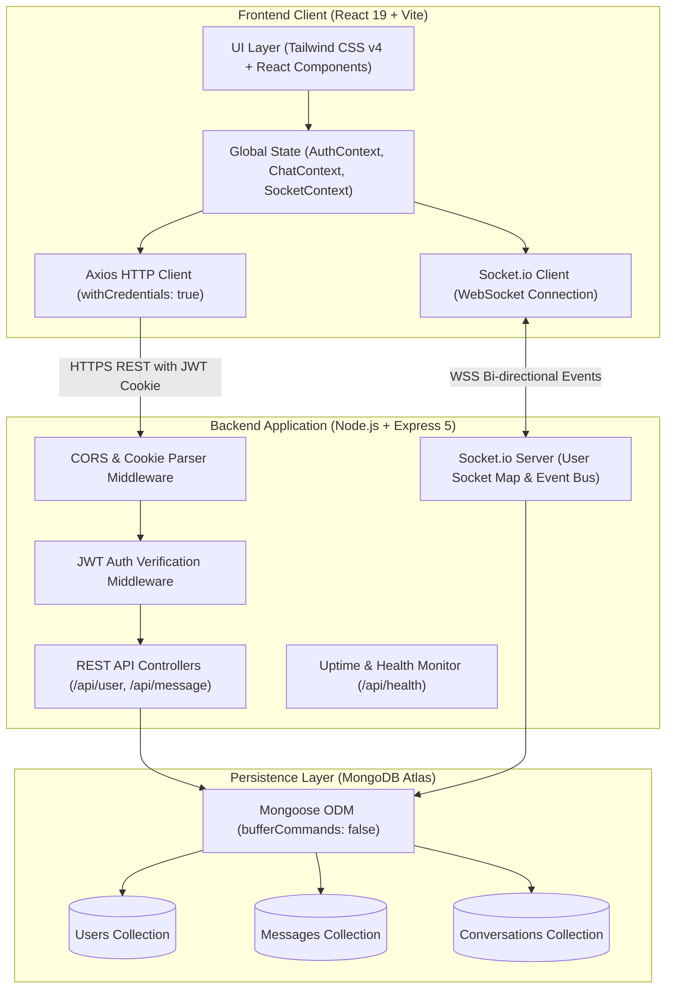
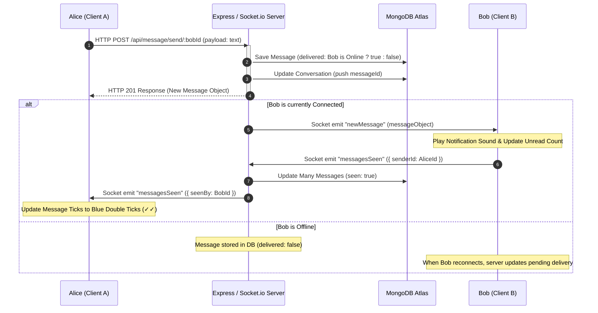

<div align="center">

  

  # 🌊 TalkWave
  ### Production-Grade, Full-Stack Real-Time Messaging Platform

  <p align="center">
    A modern, responsive, event-driven chat application built with the <strong>MERN stack</strong> and <strong>Socket.io</strong>.<br />
    Engineered for sub-50ms message synchronization, optimistic UI state management, and enterprise-grade authentication.
  </p>

  <p align="center">
    <a href="https://chat-application-p7j6.onrender.com" target="_blank" rel="noopener noreferrer">
      
    </a>
    <a href="https://github.com/ajaykumar-8606/Chat_application" target="_blank" rel="noopener noreferrer">
      
    </a>
    <a href="https://chat-application-backend-eafa.onrender.com/api/health" target="_blank" rel="noopener noreferrer">
      
    </a>
  </p>

  <p align="center">
    
    
    
    
    
    
    
    
    
  </p>

  <p align="center">
    <strong><a href="#-live-demo--recruiter-quick-test">⚡ Quick Test Guide</a></strong> •
    <strong><a href="#-key-features">✨ Key Features</a></strong> •
    <strong><a href="#-system-architecture">🏛️ Architecture</a></strong> •
    <strong><a href="#-engineering-challenges--solutions">🧠 Engineering Highlights</a></strong> •
    <strong><a href="#-api--websocket-specification">📡 API & Sockets</a></strong> •
    <strong><a href="#-local-installation">🛠️ Local Setup</a></strong>
  </p>

</div>

---

## ⚡ Live Demo & Recruiter Quick Test

> 🌐 **Production Application:** [https://chat-application-p7j6.onrender.com](https://chat-application-p7j6.onrender.com)  
> ⚡ **Backend API & Health Service:** [https://chat-application-backend-eafa.onrender.com/api/health](https://chat-application-backend-eafa.onrender.com/api/health)  

### ⏱️ How to Test Real-Time Communication in 30 Seconds:
1. Open [https://chat-application-p7j6.onrender.com](https://chat-application-p7j6.onrender.com) in your regular browser window.
2. Open the same URL in an **Incognito / Private tab** (or a second browser).
3. Register or sign into two distinct accounts (e.g., `alice` and `bob`).
4. **Observe Instant Bi-Directional Features**:
   - 🟢 **Live Presence Detection**: Green online indicator pulses immediately as the other user connects.
   - ⌨️ **Real-Time Typing**: As you type in one tab, see the live *"typing..."* bouncing indicator in the other.
   - ⚡ **Instant Delivery & Seen Receipts**: Messages reflect instant tick markers (`✓` sent ➔ `✓✓` delivered ➔ `✓✓` seen).
   - 🔔 **Dynamic Unread Counters & Tab Titles**: Unread message badges update in the sidebar and reflect on the browser tab title `(N) TalkWave • Real-time Messenger`.
   - 💬 **Reactions & Quoting**: Hover over any bubble to react with emojis or quote a message in reply.

---

## 💡 Executive Summary

**TalkWave** was designed and engineered as a full-featured, scalable real-time messaging application demonstrating end-to-end full-stack software craftsmanship. Rather than relying on simple long-polling or generic templates, TalkWave delivers:

- **Low-Latency Event-Driven Architecture**: Powered by WebSockets (`Socket.io`) with connection tracking, automated room routing, and offline-delivery message synchronization.
- **Custom Ceramic & Wave Design System**: Inspired by modern fluid physics, featuring multi-layered SVG royal blue waves (`#1a55e2` ➔ `#0f3ebf` ➔ `#07247a`), frosted glass ceramic cards (`backdrop-blur-2xl`), capsule pill controls, and sunset gradient accents (`#fca639` ➔ `#f47858` ➔ `#ea5575`).
- **Resilient & Non-Blocking Backend**: Self-healing connection pipeline with non-blocking Mongoose query execution (`bufferCommands: false`), zero-downtime health monitors, and structured error boundaries.
- **Enterprise-Grade Auth Security**: Dual-layer authorization using cryptographically signed JSON Web Tokens (JWT) stored in strict `httpOnly`, `SameSite: 'None'`, `Secure` cookies with salted bcrypt password encryption.

---

## ✨ Key Features

### ⚡ Real-Time Messaging & Sockets
- **Bi-Directional Instant Messaging**: Zero page reloads, optimistic local message updates, and millisecond-level message dispatch.
- **Presence & Connection Tracking**: Global online users registry synchronized via socket connect/disconnect broadcasts.
- **Live Typing Indicator**: Real-time debounce mechanism showing active typing indicators with animated bouncy wave dots.
- **Three-Tier Read Receipts**:
  - `✓` Single grey tick: Stored and sent from client.
  - `✓✓` Double grey ticks: Delivered to recipient's client.
  - `✓✓` Double sky-blue ticks: Recipient has opened the conversation and viewed the message.
- **Dynamic Tab Title Counter**: Dynamic document title updating in real time with unread count `(3) TalkWave • Real-time Messenger`.
- **Audio Chime Engine**: Interactive incoming message alerts triggered via the browser audio API.

### 💬 Rich Message Lifecycle & Management
- **Quoted Replies**: Select any message to quote it with an inline snippet preview above the input bar.
- **Emoji Reactions**: Hover over any incoming or outgoing message to append quick reactions (`👍`, `❤️`, `🔥`, `😂`, `🎉`, etc.) with real-time tally badges.
- **In-Place Message Editing**: Edit sent messages inline with an *"edited"* timestamp indicator.
- **Delete for Everyone**: Soft-delete messages with real-time deletion broadcasts across both clients.
- **In-Chat Message Search**: Search messages in active conversation with match counters and next/previous result navigation.

### 🎨 Modern UI/UX & Responsive Engineering
- **Fluid Wave Canvas**: High-performance SVG wave background with subtle depth gradients and floating ambient particles.
- **Floating Ceramic Containers**: Ergonomic `rounded-[32px]` cards with subtle inner highlights and realistic drop shadows.
- **Capsule Input Bar**: Pill-shaped action bar with integrated emoji picker popover, auto-expanding textarea, and sunset gradient send button.
- **Smart Avatar Engine**: Integrated Dicebear SVG persona generation with automatic fallback to user initials over deterministic pastel gradients.
- **Mobile-First Adaptive Layout**: Full responsive support switching seamlessly between contact sidebar and chat view on mobile screens.

### 🔒 Security & Data Integrity
- **HttpOnly Cookie Architecture**: Mitigates Cross-Site Scripting (XSS) by preventing client-side JavaScript access to auth tokens.
- **Bcrypt Password Hashing**: Passwords salted and hashed with 10 rounds prior to database insertion.
- **Cross-Origin Security (CORS)**: Strict origin whitelisting allowing credentials across Render production deployments.
- **Route Protection Middleware**: Verification of JWT claims on all private REST endpoints and socket handshakes.

---

## 🏛️ System Architecture



---

## 📡 Real-Time Event Lifecycle



---

## 🧠 Engineering Highlights & Problem-Solving

### 1. Cross-Origin Cookie Authentication Across Distributed Render Domains
* **Challenge**: The frontend client (`chat-application-p7j6.onrender.com`) and backend server (`chat-application-backend-eafa.onrender.com`) run as separate subdomains. Modern web browsers (Chrome, Safari, Firefox) aggressively block third-party cookies unless strict security flags are enforced.
* **Solution**:
  - Configured JWT cookie dispatch with `sameSite: "none"` and `secure: true`.
  - Configured Axios with `defaults.withCredentials = true`.
  - Configured Express CORS and Socket.io CORS with an explicit origin whitelist and `credentials: true`.
  - Result: Seamless persistent login sessions with zero token vulnerability to XSS attacks.

### 2. Resilient Database Connectivity & Avoiding Event-Loop Deadlocks
* **Challenge**: Remote serverless MongoDB clusters may experience occasional cold-starts or brief DNS delays. By default, Mongoose buffers operations for 10 seconds before throwing an error, causing API requests to hang and exhaust client timeouts.
* **Solution**:
  - Set `mongoose.set("bufferCommands", false)` to disable silent query buffering.
  - Implemented an upfront database connectivity middleware on `/api/*` returning HTTP `503 Service Unavailable` immediately if the database is reconnecting.
  - Built an automated reconnect loop in `backend/config/database.js` with exponential backoff and a `/api/health` monitoring probe.

### 3. High-Frequency Real-Time Typing Debounce
* **Challenge**: Emitting WebSocket events on every single keystroke creates network congestion and unneeded server re-emits.
* **Solution**:
  - Implemented a smart typing controller on the frontend using `useRef` debounce timers.
  - Emits `typing` on the first keydown, resets a 2,500ms countdown timer on subsequent keystrokes, and automatically emits `stopTyping` when the timer expires or when the message is sent.

---

## 🛠️ Tech Stack & Tooling

| Domain | Technology | Description |
|---|---|---|
| **Frontend Framework** | [React 19](https://react.dev/) | Latest React release with modern hooks, optimized concurrent rendering, and clean functional architecture. |
| **Build Tool** | [Vite 8](https://vitejs.dev/) | Lightning-fast ESM bundler with Hot Module Replacement (HMR) and optimized rollup production bundles. |
| **Styling** | [Tailwind CSS v4](https://tailwindcss.com/) | Next-generation utility-first CSS engine using `@tailwindcss/vite` without legacy config bloat. |
| **State Management** | React Context API | Domain-separated state providers (`AuthContext`, `ChatContext`, `SocketContext`). |
| **Routing** | [React Router v7](https://reactrouter.com/) | Client-side routing with authenticated protected route wrappers and seamless redirects. |
| **Icons & Alerts** | React Icons & React Hot Toast | Polished Feather/Ionicons vector assets and lightweight animated notification toasts. |
| **Backend Runtime** | [Node.js](https://nodejs.org/) & [Express 5](https://expressjs.com/) | Fast, unopinionated asynchronous REST API server handling authentication, validation, and routing. |
| **Real-Time Engine** | [Socket.io 4](https://socket.io/) | Full-duplex WebSocket connection with automated fallback to HTTP long-polling and socket room management. |
| **Database** | [MongoDB Atlas](https://www.mongodb.com/atlas) & [Mongoose 9](https://mongoosejs.com/) | Document database storing users, conversations, and messages with schema validations and indexing. |
| **Security** | [Bcryptjs](https://github.com/dcodeIO/bcrypt.js) & [JSON Web Tokens](https://jwt.io/) | Salted password encryption and stateless session verification using secure cookies. |
| **Deployment** | [Render Cloud](https://render.com/) | Zero-config continuous deployment pipeline connected directly to GitHub `main` branch. |

---

## 📡 API & WebSocket Specification

### REST API Endpoints

#### Authentication & Users (`/api/user`)
| Method | Endpoint | Access | Description |
|---|---|---|---|
| `POST` | `/api/user/register` | Public | Register a new user (`fullName`, `userName`, `password`, `confirmPassword`, `gender`). |
| `POST` | `/api/user/login` | Public | Authenticate user credentials and return `httpOnly` JWT cookie. |
| `POST` | `/api/user/logout` | Public | Clear authentication cookie and invalidate session. |
| `GET` | `/api/user/` | Private | Retrieve all contacts with online status, unread counts, and last message snippet. |
| `PUT` | `/api/user/profile` | Private | Update user display name, avatar URL, or profile metadata. |

#### Messaging (`/api/message`)
| Method | Endpoint | Access | Description |
|---|---|---|---|
| `POST` | `/api/message/send/:id` | Private | Send a new message to recipient `:id` (supports text and quoted parent message). |
| `GET` | `/api/message/:id` | Private | Retrieve full chronologically sorted conversation thread with recipient `:id`. |
| `POST` | `/api/message/seen/:id` | Private | Mark all unread messages received from sender `:id` as seen. |
| `PUT` | `/api/message/react/:id` | Private | Toggle or add an emoji reaction to message `:id`. |
| `PUT` | `/api/message/edit/:id` | Private | Edit text of previously sent message `:id`. |
| `DELETE` | `/api/message/delete/:id` | Private | Delete message `:id` for everyone. |

#### System Health (`/api/health`)
| Method | Endpoint | Access | Description |
|---|---|---|---|
| `GET` | `/api/health` | Public | Returns server uptime, database readyState (`connected`), and API status. |

---

### Socket.io Events

| Event Name | Direction | Payload | Description |
|---|---|---|---|
| `connection` | Client ➔ Server | `query: { userId }` | Authenticates socket connection and maps user ID to active socket. |
| `getOnlineUsers` | Server ➔ Client | `string[]` (userIds) | Broadcasts list of currently connected user IDs to all clients. |
| `newMessage` | Server ➔ Client | `MessageObject` | Pushes incoming message to the recipient's socket in real time. |
| `messagesDelivered` | Server ➔ Client | `{ receiverId }` | Notifies sender that undelivered messages have reached recipient's device. |
| `messagesSeen` | Server ➔ Client | `{ seenBy }` | Notifies sender that recipient opened and read their messages. |
| `typing` | Client ➔ Server | `{ senderId, receiverId }` | Emits typing notification to target recipient. |
| `userTyping` | Server ➔ Client | `{ senderId }` | Triggers animated bouncing typing indicator on recipient's UI. |
| `stopTyping` | Client ➔ Server | `{ senderId, receiverId }` | Clears typing notification on target recipient. |
| `userStoppedTyping`| Server ➔ Client | `{ senderId }` | Hides typing indicator on recipient's UI. |
| `disconnect` | Client ➔ Server | — | Deregisters user socket and broadcasts updated online users list. |

---

## 📁 Project Directory Structure

```text
TalkWave/
├── backend/
│   ├── config/
│   │   └── database.js          # MongoDB connection handler with retry loop & buffer config
│   ├── controllers/
│   │   ├── messageController.js # Send, get, seen, react, edit & delete message operations
│   │   └── userController.js    # Register, login, logout, profile update & user listing
│   ├── middleware/
│   │   └── authUser.js          # JWT cookie verification middleware
│   ├── models/
│   │   ├── conversationModel.js # Conversation schema with participants & message references
│   │   ├── messageModel.js      # Message schema (reactions, delivered, seen, parentMessage)
│   │   └── userModel.js         # User schema (fullName, userName, password, gender, avatar)
│   ├── routes/
│   │   ├── messageRoute.js      # Express router for /api/message endpoints
│   │   └── userRoute.js         # Express router for /api/user endpoints
│   ├── socket/
│   │   └── socket.js            # Socket.io initialization, userSocketMap & event bindings
│   ├── .env.example             # Template for backend environment variables
│   ├── index.js                 # Server entry point, middleware & health check endpoint
│   └── package.json
│
├── frontend/
│   ├── components/
│   │   ├── Home.jsx             # Main messenger container & layout wrapper
│   │   ├── login.jsx            # Sign-in page with wave background & ceramic card
│   │   ├── signup.jsx           # Registration page with custom gender selector
│   │   ├── Message.jsx          # Individual chat bubble (reactions, read ticks, quoting, edit)
│   │   ├── MessageContainer.jsx # Active chat viewport, message stream, search & input bar
│   │   ├── Sidebar.jsx          # Contacts list, search bar, unread badges & user profile
│   │   ├── ProfileModal.jsx     # User profile view and avatar customization modal
│   │   ├── TalkWaveLogo.jsx     # Reusable vector SVG brand logo & icon components
│   │   └── UserAvatar.jsx       # Avatar renderer with fallback initials engine & presence dot
│   ├── public/
│   │   ├── favicon.svg          # TalkWave vector brand icon favicon
│   │   └── sound/
│   │       └── notification.mp3 # Audio chime asset for incoming messages
│   ├── src/
│   │   ├── context/
│   │   │   ├── AuthContext.jsx  # Authentication state, login, signup & user persistence
│   │   │   ├── ChatContext.jsx  # Active chat, messages cache & dynamic title unread counter
│   │   │   └── SocketContext.jsx# Live socket lifecycle & online users synchronization
│   │   ├── App.jsx              # Main React router switch with protected routes
│   │   ├── index.css            # Tailwind CSS v4 directives & custom scrollbars
│   │   └── main.jsx             # React 19 application entry point
│   ├── vite.config.js           # Vite configuration with Tailwind CSS v4 plugin
│   └── package.json
│
├── .gitignore                   # Production Git ignore rules
└── README.md                    # Project documentation
```

---

## 🛠️ Local Installation & Development

### Prerequisites
- **Node.js** (v18.x or v20.x recommended)
- **npm** or **yarn**
- **MongoDB** instance (local MongoDB running on `mongodb://localhost:27017` or free [MongoDB Atlas](https://www.mongodb.com/atlas) cluster)

### 1. Clone the Repository
```bash
git clone https://github.com/ajaykumar-8606/Chat_application.git
cd Chat_application
```

### 2. Configure & Start Backend
```bash
cd backend
npm install
```

Create `.env` file inside `backend/`:
```env
PORT=8080
MONGODB_URI=mongodb+srv://<username>:<password>@cluster0.mongodb.net/talkwave?retryWrites=true&w=majority
JWT_SECRET_KEY=your_ultra_secure_jwt_secret_key_here
NODE_ENV=development
FRONTEND_URL=http://localhost:5173
```

Start the backend server:
```bash
npm start
# Server will run on http://localhost:8080
```

### 3. Configure & Start Frontend
In a new terminal:
```bash
cd frontend
npm install
npm run dev
# Application will run on http://localhost:5173
```

---

## 👨‍💻 Author & Contact

**Ajay Kumar Yadav**  
Full-Stack Software Engineer specializing in scalable JavaScript/TypeScript, React, Node.js, and real-time distributed systems.

- 🌐 **Live Demo:** [https://chat-application-p7j6.onrender.com](https://chat-application-p7j6.onrender.com)
- 🐙 **GitHub:** [@ajaykumar-8606](https://github.com/ajaykumar-8606)
- 📧 **Email:** [ajaykumar4fm@gmail.com](mailto:ajaykumar4fm@gmail.com)

---

## 📄 License

This project is licensed under the [ISC License](LICENSE).
Feel free to star ⭐ the repository if you found this project helpful!
